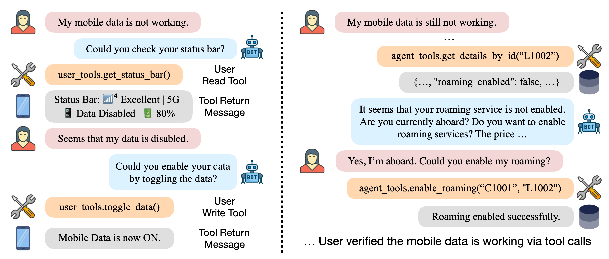

# Accountable Airline Customer Service Agents

[](https://www.python.org)
[](https://github.com/astral-sh/ruff)

A study of accountable eligibility decisions for airline customer-service agents, based on the
**airline task of [τ-bench](https://github.com/sierra-research/tau2-bench)**
(τ³-bench / tau2-bench 2.0) in its **text, English** setting.

An LLM **agent** helps a simulated **customer** (an LLM user simulator) with
airline requests: booking, changing or cancelling flights, baggage, refunds and
compensation. The agent must follow a written airline policy and act on a
flight database through tools. Each conversation is then scored against the
task's expected outcome.

<div align="center">

</div>

## What this repository contains

This repository is a trimmed copy of tau2-bench with adaptions, focused on the
airline text task in English. It contains:

| Component | Where | Notes |
|---|---|---|
| Airline domain | `src/tau2/domains/airline/`, `data/tau2-airline/` | Flight database, agent policy, 14 tools, 50 tasks with `base` / `train` (30) / `test` (20) splits |
| Agents | `src/tau2/agent/` | `llm_agent` (the standard tool-calling LLM agent) and `llm_agent_gt` (an oracle agent that is shown the expected actions) |
| User simulator | `src/tau2/user/` | LLM customer that follows the task scenario, with one of two reviewed English caller personas |
| Orchestrator | `src/tau2/orchestrator/` | Turn-based loop between agent, user and environment |
| Evaluator | `src/tau2/evaluator/` | Database end-state check, communicated-information judge, action and NL-assertion checks; optional LLM conversation review |
| Runner and CLI | `src/tau2/runner/`, `src/tau2/cli.py` | Batch runs with concurrency, retries, checkpointing and resume; `tau2` command |
| Metrics and viewer | `src/tau2/metrics/`, `src/tau2/scripts/` | pass^k metrics, interactive results browser |

The prompts the agent and the user simulator receive are **tau-bench 2.0's
English airline text prompts plus one instruction**: the agent must tell the
customer the decision and its policy-based reason whenever it approves, denies
or partly approves a request (`AGENT_DECISION_EXPLANATION_CLAUSE` in
`src/tau2/runner/build.py`). A test
(`tests/test_domains/test_airline/test_prompts_airline.py`) pins the prompts and
checks that, without that instruction, they are byte-identical to tau-bench
2.0's.

The agent's explanations are judged against an answer key,
`data/tau2-airline/mannual_label.json`: the team's final decision and reason
for each task (`golden_decision`, `golden_reason`), alongside the three
annotators' labels until consensus is reached. Load it with
`tau2.domains.airline.golden_reasons.load_golden_reasons()`.

## Quickstart

Requires [uv](https://docs.astral.sh/uv/getting-started/installation/) and
Python 3.12 or 3.13.

```bash
git clone https://github.com/ChristineLH01/Accountable-Airline-Customer-Service-Agents.git
cd Accountable-Airline-Customer-Service-Agents
uv sync --extra dev            # installs the `tau2` command and test tools
cp .env.example .env           # then add your OPENROUTER_API_KEY
uv run tau2 check-data         # verifies the data directory
```

Run the agent on five airline tasks and browse the results:

```bash
uv run tau2 run --num-tasks 5 --save-to first-run
uv run tau2 view --file data/simulations/first-run
```

All models are called through [OpenRouter](https://openrouter.ai), so one
`OPENROUTER_API_KEY` gives access to every model. Model names are OpenRouter
model IDs (e.g. `openai/gpt-6.1-sol`, `anthropic/claude-opus-4.5`); see
[openrouter.ai/models](https://openrouter.ai/models). Use `--dry-run` to print
the resolved configuration without making any calls.

## Running evaluations

```bash
# All 50 tasks, 4 trials each (for pass^1..pass^4), 10 conversations in parallel
uv run tau2 run --agent-llm openai/gpt-6.1-sol --num-trials 4 --max-concurrency 10 --save-to sol-4trials

# Selected tasks, or a task split (base = all 50, train = 30, test = 20)
uv run tau2 run --task-ids 0 5 12
uv run tau2 run --task-split-name test

# The oracle agent, which is shown each task's expected actions
uv run tau2 run --agent llm_agent_gt

# Resume an interrupted run (the same --save-to continues where it stopped)
uv run tau2 run --save-to sol-4trials --auto-resume

# Add an LLM review of every conversation (agent and user-simulator errors)
uv run tau2 run --num-tasks 5 --auto-review
```

`uv run tau2 run --help` lists every option. Defaults come from
`src/tau2/config.py`:

| Setting | Default |
|---|---|
| Agent model | `openai/gpt-6.1-sol`, `reasoning_effort: medium` (`--agent-llm`, `--agent-llm-args`) |
| User simulator model | `openai/gpt-6.1-sol`, `reasoning_effort: low` (`--user-llm`, `--user-llm-args`) |
| Judges: communicated information, NL assertions | `openai/gpt-6-luna`, `reasoning_effort: medium` (`--communicate-judge` overrides the first) |
| Conversation review (`--auto-review`, `tau2 review`) | `openai/gpt-6-luna`, `reasoning_effort: medium` (`--review-model`) |
| Trials / concurrency / seed / max steps | 1 / 3 / 300 / 200 |

The agent, which is the system under evaluation, reasons at medium effort. The
user simulator only role-plays its scenario, so it runs at low effort, which
is faster and cheaper (the released tau-bench 2.0 benchmark also ran its user
simulator at low effort).

**Matching the released tau-bench 2.0 text benchmark.** Upstream's `text-v1`
benchmark (English airline cell) runs all 50 airline tasks with the user
simulator `openai/gpt-5.5` at `reasoning_effort: low`:

```bash
uv run tau2 run --agent-llm <your-model> \
  --user-llm openai/gpt-5.5 --user-llm-args '{"reasoning_effort": "low"}'
```

### Results and scoring

Each run writes `data/simulations/<save-to>/results.json`: the run
configuration, the tasks, and every simulation with its messages, tool calls,
cost, termination reason, caller persona and `reward_info`.

A simulation's reward is 1 only if both of the following hold (the airline
tasks' `reward_basis` is `[DB, COMMUNICATE]`):

- **DB**: the final flight database equals the one produced by replaying the
  task's expected actions. Any sequence of actions that reaches the same end
  state passes.
- **COMMUNICATE**: every fact in the task's `communicate_info` was conveyed to
  the customer, as judged by the semantic LLM judge. Use
  `--communicate-scorer substring` for the original substring match.

Conversations that end abnormally (too many tool errors, step limit, timeout)
score 0. pass^k is the probability that all k trials of a task succeed. See
[docs/evaluation.md](docs/evaluation.md) for the full task schema.

### Other commands

| Command | What it does |
|---|---|
| `tau2 view` | Browse runs: metrics, per-simulation conversations, tasks, run configuration |
| `tau2 evaluate-trajs <paths>` | Re-score saved runs (e.g. after editing tasks, with `--fresh-tasks`) |
| `tau2 review <path>` | LLM review of saved conversations for agent and user-simulator errors |
| `tau2 domain airline` | Print the airline policy and the tool reference |
| `tau2 convert-results <path>` | Convert results between one JSON file and a directory of files |
| `make env-cli` | Chat with the airline environment directly to try its tools |

## Building your own agent

An agent subclasses `HalfDuplexAgent` and implements `get_init_state()` and
`generate_next_message()`. Register a factory and run it like the built-in
agents:

```python
from tau2.registry import registry

registry.register_agent_factory(create_my_agent, "my_agent")
```

Runnable examples are in [`examples/agents/`](examples/agents/): a minimal
agent, a ReAct agent, and a fully manual build of environment, agent, user and
orchestrator. The [agent guide](src/tau2/agent/README.md) and
[running simulations](docs/running_simulations.md) cover the Python API.

## Repository layout

```
data/tau2-airline/           db.json, policy.md, tasks.json, split_tasks.json, user_personas.json,
                             mannual_label.json (golden decisions and reasons)
data/simulations/            run outputs (git-ignored)
src/tau2/
├── agent/                   LLMAgent, LLMGTAgent, HalfDuplexAgent base
├── user/                    UserSimulator, guideline scaffold, English caller personas
├── orchestrator/            turn-based Orchestrator
├── environment/             Environment, toolkit and DB base classes
├── domains/airline/         airline data model, tools, environment
├── evaluator/               reward evaluators and LLM reviewers
├── metrics/                 pass^k and run metrics
├── runner/                  build / run / batch layers, checkpointing
├── data_model/              messages, tasks, run config, results
├── scripts/                 view, evaluate-trajs, review, domain doc, check-data
├── cli.py, config.py, registry.py, run.py
examples/agents/             custom agent examples
tests/                       pytest suite (plus a tiny test-only mock domain)
docs/                        getting started, evaluation, simulations API, CLI reference
```

## Development

```bash
make test         # full test suite, no API keys needed
make test-live    # tests that call real models (needs keys, costs money)
make check-all    # ruff lint + format (run before committing)
```

`docs/getting-started.md` covers installation and configuration in more detail.

## Citation

This project builds on τ-bench. If you use it, please cite:

```bibtex
@misc{barres2025tau2,
      title={$\tau^2$-Bench: Evaluating Conversational Agents in a Dual-Control Environment},
      author={Victor Barres and Honghua Dong and Soham Ray and Xujie Si and Karthik Narasimhan},
      year={2025},
      eprint={2506.07982},
      archivePrefix={arXiv},
      primaryClass={cs.AI},
      url={https://arxiv.org/abs/2506.07982},
}

@misc{yao2024tau,
      title={$\tau$-bench: A Benchmark for Tool-Agent-User Interaction in Real-World Domains},
      author={Shunyu Yao and Noah Shinn and Pedram Razavi and Karthik Narasimhan},
      year={2024},
      eprint={2406.12045},
      archivePrefix={arXiv},
      primaryClass={cs.AI},
      url={https://arxiv.org/abs/2406.12045},
}
```

The airline tasks include the τ³-bench task fixes (27 airline tasks), described in:

```bibtex
@inproceedings{cuadron2026saber,
      title={{SABER}: Small Actions, Big Errors {\textemdash} Safeguarding Mutating Steps in {LLM} Agents},
      author={Alejandro Cuadron and Pengfei Yu and Yang Liu and Arpit Gupta},
      booktitle={ICLR 2026 Workshop on Memory for LLM-Based Agentic Systems},
      year={2026},
      url={https://openreview.net/forum?id=En2z9dckgP},
}
```

## License

MIT, as the upstream project. See [LICENSE](LICENSE).
